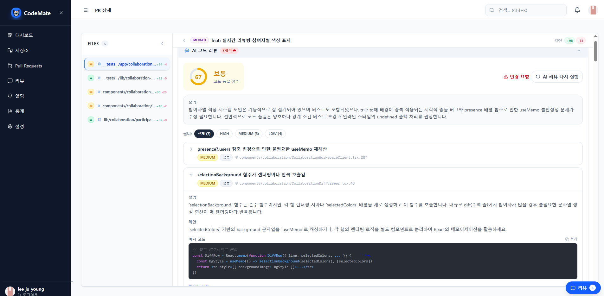

# AI 코드 리뷰를 기다리지 않아도 되도록 만들기

CodeMate는 GitHub의 Pull Request(PR)를 가져와 변경된 코드를 함께 살펴보고, AI에게 코드 리뷰를 요청할 수 있는 서비스다. 사용자가 리뷰 버튼을 누르면 서버는 GitHub에서 변경 파일을 가져와 분석할 내용을 만들고, AI의 응답에서 코드 이슈와 점수를 추출해 저장한다.

문제는 이 과정이 버튼을 누르는 순간 끝나는 작업이 아니라는 점이었다. GitHub에서 파일을 가져오는 데도 시간이 걸리고, AI가 코드를 분석한 뒤 결과를 반환할 때까지도 기다려야 한다. 그동안 API 응답이 돌아오지 않는다면 사용자는 같은 화면에서 로딩 상태를 지켜봐야 한다. 리뷰 요청이 정상적으로 접수된 것인지, 화면을 벗어나도 되는지조차 분명하지 않다.

사용자에게 중요한 것은 분석이 끝날 때까지 화면을 붙잡고 있는 일이 아니라, **리뷰를 요청해 두고 다른 작업을 하다가 결과가 준비되면 확인할 수 있는 것**이라고 생각했다. 그래서 CodeMate에서는 *리뷰 요청을 접수하는 일*과 *실제 리뷰를 완료하는 일*을 분리했다.

## 요청을 접수하면 먼저 응답하기

AI 분석을 하나의 API 요청 안에서 끝내려고 하면, 서버는 GitHub 조회와 AI 호출, 결과 저장이 모두 끝난 뒤에야 응답을 반환한다. 예를 들어 다음과 같이 분석 함수를 `await`한다면 브라우저는 분석이 끝날 때까지 요청의 완료를 기다린다.

```ts
// 분석이 모두 끝나야 응답이 반환되는 방식
const result = await analyzeReview(pr.id, session.user.id);
return NextResponse.json({ status: result.status });
```

반면 CodeMate에서는 요청을 받으면 먼저 `{ status: "PENDING" }`을 반환하도록 했다. 여기서 `PENDING`은 **분석이 완료됐다는 뜻이 아니라 요청을 접수했다는 응답**이다. 이 시점에 실제 `Review` 기록이나 알림까지 모두 저장됐다고 보장하는 것은 아니다. 후속 작업은 응답 이후 서버에서 시작된다.


이렇게 하면 사용자는 분석이 완료될 때까지 해당 화면에 머물 필요가 없다. 다른 PR을 살펴보거나 작업을 이어가고, 나중에 알림 목록을 통해 결과를 확인할 수 있다. 다만 요청을 일찍 끝내는 만큼, **응답을 보낸 이후 서버가 해야 할 일을 어떻게 이어갈지**가 중요해졌다.

## `after()`로 응답 이후에도 분석 이어가기

여기서 사용한 기능이 Next.js의 `after()`다. `after()`는 Route Handler 등에서 응답이 완료된 *이후* 실행할 콜백을 등록하는 함수다. 로깅이나 분석처럼 응답을 지연시킬 필요가 없는 후속 작업에 사용할 수 있다.

중요한 점은 `after()` 안의 함수를 호출하는 시점과 API가 응답을 보내는 시점이 분리된다는 것이다. 일반적인 `await analyzeReview()`는 분석이 끝날 때까지 다음 줄로 진행하지 않지만, `after()`는 후속 작업을 등록한 뒤 응답을 반환할 수 있도록 한다. Next.js는 응답이 끝난 다음 등록된 콜백을 실행하고, 지원되는 실행 환경에서는 해당 비동기 작업이 마무리되도록 서버 실행 수명을 이어간다.

그렇다고 `after()`가 분석 작업을 별도 서버나 영구적인 작업 큐에 넣어 주는 것은 아니다. 여전히 요청이 실행된 서버 환경과 실행 시간의 제약을 받는다. 이 한계는 뒤에서 다시 다룬다.

CodeMate에서 리뷰 버튼을 눌렀을 때 이어지는 핵심 코드는 다음과 같다.

```ts
// 응답을 보낸 다음 실행할 후속 작업을 등록한다.
after(async () => {
  // 리뷰 요청이 접수되었음을 알림에 반영한다.
  await notifyReviewStatus({
    repositoryId: pr.repoId,
    prId: pr.id,
    prTitle: pr.title,
    prNumber: pr.number,
    status: "PENDING",
  });

  // GitHub 변경 파일 조회부터 AI 분석과 결과 저장까지 수행한다.
  const result = await analyzeReview(pr.id, session.user.id);

  // 같은 PR의 분석이 이미 진행 중이라면 이 요청은 더 처리하지 않는다.
  if (result.status === "SKIPPED_ACTIVE") return;

  // 저장된 분석 결과에 따라 완료 또는 실패 알림으로 갱신한다.
  await notifyReviewStatus({
    repositoryId: pr.repoId,
    prId: pr.id,
    prTitle: pr.title,
    prNumber: pr.number,
    status: result.status,
  });
});

// AI 분석 완료를 기다리지 않고 요청 접수 여부부터 응답한다.
return NextResponse.json({ status: "PENDING" });
```

코드를 보면 `after()` 안에서 알림을 먼저 갱신하고, `analyzeReview()`를 실행한 다음 최종 상태를 다시 알림에 반영한다. 하지만 브라우저는 이 모든 과정이 끝날 때까지 기다리지 않는다. 마지막 줄의 `PENDING` 응답을 받으면 해당 HTTP 요청은 끝난다.

그 뒤 서버에서는 순서대로 작업이 이어진다. 먼저 리뷰 요청이 접수되었다는 알림을 처리한다. 이어서 `analyzeReview()`가 GitHub PR의 변경 파일을 조회하고 AI 분석을 수행한다. 분석 과정에서 생성한 리뷰 기록과 결과는 DB의 `Review`에 저장된다. 분석이 완료되면 `COMPLETED`, 실패하면 `FAILED` 상태가 반환되고, 마지막으로 그 상태에 맞춰 알림을 갱신한다.

이 흐름에서 구분해야 할 것은 **API가 성공적으로 응답했다는 사실과 AI 리뷰가 성공적으로 끝났다는 사실은 다르다**는 점이다. 요청을 접수한 뒤에도 GitHub 조회나 AI 호출에서 문제가 발생할 수 있다. 그래서 사용자가 나중에 확인할 수 있도록 리뷰의 최종 상태와 알림을 별도로 관리해야 했다.

또한 분석 시작 경로가 리뷰 버튼만 있는 것도 아니다. GitHub Webhook으로 PR이 열리거나 변경됐을 때도 분석을 시작할 수 있다. 이때도 Webhook에 대한 응답을 먼저 반환하고 `after()`에서 후속 작업을 진행하며, 실제 AI 리뷰 로직은 같은 `analyzeReview()` 함수로 이어진다.

## 같은 PR을 두 번 분석하지 않으려면

분석을 요청하는 경로가 둘 이상이다 보니 또 다른 문제를 고려해야 했다. 사용자가 리뷰 버튼을 연달아 누르거나, 비슷한 시점에 Webhook이 들어오면 동일한 PR에 대한 분석이 동시에 시작될 수 있다.

AI 리뷰는 GitHub의 변경 파일을 조회하고 외부 AI API를 호출하는 작업이다. 같은 분석이 여러 번 실행되면 불필요한 호출이 발생할 뿐 아니라, 늦게 끝난 분석이 다른 결과나 알림에 영향을 줄 여지도 있다. 버튼을 비활성화하는 것만으로는 다른 브라우저 탭이나 Webhook에서 발생한 요청까지 제어할 수 없다.

이를 막기 위해 `analyzeReview()`는 분석을 시작하기 전에 해당 PR에 이미 진행 중인 리뷰가 있는지 확인한다. 진행 중인 리뷰가 없다면 새 `Review`를 생성한다. 하지만 이 확인만으로는 충분하지 않다. 서로 다른 두 요청이 거의 동시에 조회하면 둘 다 '진행 중인 리뷰가 없다'고 판단할 수 있기 때문이다.

그래서 DB에도 **한 PR에 진행 중인 리뷰는 하나만 존재하도록** 제약을 두었다.

```sql
-- 아직 처리 중인 리뷰에 한해서 PR별 중복 생성을 막는다.
CREATE UNIQUE INDEX "review_active_unique"
  ON "Review" ("pullRequestId")
  WHERE status IN ('PENDING', 'IN_PROGRESS');
```

이것은 일반적인 고유 인덱스가 아니라 조건을 가진 **부분 고유 인덱스(Partial Unique Index)**다. 동일한 `pullRequestId`라도 상태가 `PENDING`이나 `IN_PROGRESS`인 리뷰는 한 개만 허용한다. 반면 이미 `COMPLETED` 또는 `FAILED`가 된 리뷰까지 제한하지는 않는다. 기존 리뷰 이력을 남겨 두면서, 나중에 같은 PR을 다시 분석할 수 있도록 하기 위해서다.

예를 들어 두 요청이 동시에 진행 중인 리뷰를 조회해 둘 다 없다고 판단하더라도, 실제로 레코드를 생성할 때는 DB의 고유 제약이 적용된다. 하나가 먼저 생성되면 다른 하나는 충돌한다. CodeMate에서는 이 충돌을 이미 분석 중인 작업이 있다는 신호로 처리해 `SKIPPED_ACTIVE`를 반환한다. 앞서 본 `after()` 코드에서 이 상태일 때 후속 알림 갱신을 건너뛰는 이유도 여기에 있다.

애플리케이션에서 먼저 확인하는 로직은 불필요한 생성을 줄여 주고, DB 제약은 동시 요청이 몰렸을 때도 중복 생성을 막는 마지막 기준이 된다.

## 분석이 끝나면 알림에서 결과 확인하기

요청을 빠르게 끝냈다면, 이제 사용자는 분석이 언제 끝났는지 알 수 있어야 한다. CodeMate에서는 분석 상태를 별도 알림으로 연결했다.

분석이 진행되는 동안에는 해당 PR에 대한 요청 접수 알림을 처리하고, 분석이 끝난 후에는 그 알림을 완료 또는 실패 상태에 맞게 갱신한다. 알림을 허용한 사용자에 대해 같은 PR의 AI 리뷰 알림이 이미 있으면 제목과 메시지를 바꾸고 다시 읽지 않은 상태로 만든다. 기존 알림이 없으면 새로 생성한다. 따라서 분석 과정에서 상태가 달라질 때마다 똑같은 알림을 계속 추가하는 방식은 아니다.

분석에 성공했다면 저장된 리뷰 요약과 코드 이슈를 확인할 수 있고, 실패했다면 실패 상태와 이유를 기록해 결과를 구분할 수 있도록 한다. 다만 DB에 알림이 갱신되었다고 해서 그 순간 사용자의 화면에 바로 나타나는 것은 아니다. 현재 알림 목록은 주기적으로 데이터를 다시 조회하므로 실제 화면 반영까지는 차이가 있을 수 있다.



사용자는 다른 작업을 하다가 알림 목록에서 완료 여부를 확인하고, 해당 PR로 돌아가 리뷰 결과를 살펴볼 수 있다. 첫 API 응답은 어디까지나 요청 접수 여부만 알려 주고, 실제 AI 리뷰 결과는 서버에 저장된 뒤 조회한다. **요청 결과를 즉시 전달하는 대신, 완료 여부를 나중에 확인할 수 있는 흐름**으로 만든 셈이다.

## `after()`를 사용할 때 남는 한계

이번 구현에서는 `after()` 덕분에 AI 분석이 끝날 때까지 HTTP 응답을 붙잡아 둘 필요가 없어졌다. 다만 응답을 먼저 반환한다고 해서 이후 작업의 실행이 무조건 보장되는 것은 아니다.

Next.js 공식 문서에 따르면 `after()`의 실행 시간은 해당 라우트에 적용되는 최대 실행 시간의 영향을 받는다. CodeMate의 요청 API에는 `maxDuration = 300`이 설정되어 있지만, 이는 300초 동안 언제나 작업이 완료된다는 보장이 아니라 실행 환경에서 허용하는 최대 시간 설정이다. 실제 지원 여부와 제한은 배포 환경에 따라 달라질 수 있다.

또한 `after()`는 작업을 영구 저장하거나 실패한 작업을 자동으로 다시 실행하는 기능을 제공하지 않는다. 서버 실행이 중단되거나 허용 시간을 넘겨 분석이 끝나지 못하는 상황까지 안정적으로 처리하려면, 작업 상태를 별도로 관리하고 재시도할 수 있는 큐나 워커 구조를 고려해야 한다. 특히 요청 접수 응답을 보냈지만 실제 분석이 시작되지 못한 경우까지 처리하려면 지금보다 명확한 작업 보장 방식이 필요하다.

현재 CodeMate에서는 요청을 먼저 반환하고 그 이후 분석과 알림 갱신을 서버에서 이어가는 방식을 사용하고 있다. 이 작업에서 중요했던 것은 `after()` 하나를 도입하는 일보다, **사용자가 기다려야 하는 시점과 서버가 끝까지 처리해야 하는 작업을 분리하고, 그 결과를 다시 사용자가 확인할 수 있게 만드는 것**이었다.
